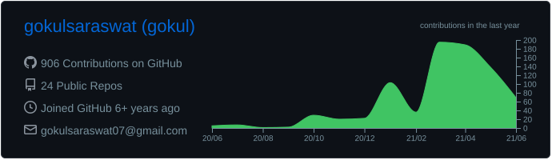
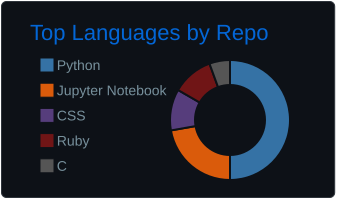
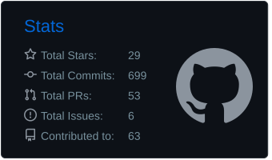

<!-- Profile README for gokulsaraswat -->

  

<h1 align="center">Gokul Saraswat</h1>
<h3 align="center">Backend Engineer • Java • Spring Boot • Oracle SQL • Kafka • Production Reliability</h3>

  

  
  
  
  

  
  

  
  
  
  
  

---

## 🚀 About Me

I'm a Java Backend Engineer based in Bangalore, currently building enterprise-grade banking systems at **Oracle Financial Services Software**.

I enjoy designing backend services that are easy to consume, observable in production, and reliable under pressure. My work sits at the intersection of **microservices**, **API integration**, **database-heavy workflows**, **production debugging**, and **release ownership**.

> I like systems that stay simple for users, predictable for teams, and boring in production.

---

## 🧠 Engineering Snapshot

<table>
<tr>
<td width="50%" valign="top">

### What I bring
- Backend-first engineering mindset
- Java 8+, Spring Boot, Oracle SQL, PL/SQL
- REST / SOAP integrations and reporting pipelines
- Production support, RCA, log analysis, and debugging
- Performance tuning across enterprise workflows
- Strong DSA and problem-solving foundation

</td>
<td width="50%" valign="top">

### Why this profile stands out
- **10+ REST APIs** delivered
- **40+ production RCAs** handled
- **98% system uptime** supported
- **99.9% migration uptime** with zero data loss
- **500+ coding problems** solved
- **3★ CodeChef** (Max Rating: 1414)

</td>
</tr>
</table>

---

## 🛠️ Tech Arsenal

  

### Backend, Data & APIs
`Java 8+` `Spring Boot` `Microservices` `REST APIs` `SOAP APIs` `Oracle SQL` `PL/SQL`

### Messaging, Reporting & Enterprise Tools
`Apache Kafka` `Oracle BI Publisher (BIP)` `WebLogic` `Oracle RAD` `OBX` `OJET` `Oracle FLEXCUBE`

### DevOps & Delivery
`Docker` `Kubernetes` `GCP` `Flyway` `Grafana` `Postman` `Linux` `Git`

  
  
  
  
  
  

---

## ⚙️ Engineering Focus

- Designing clean backend modules for complex business workflows
- Building API-first integrations that reduce friction across teams
- Improving reliability, observability, and release confidence in production
- Going deeper into distributed systems, scalable microservices, and system design
- Writing code that is easier to maintain, debug, and operate over time

---

## 🔥 Featured Work

### 1) Report Microservice for Enterprise Banking
**Professional Work · Enterprise Code**

- Designed a report microservice that extracts and aggregates complex Oracle BIP data using SQL
- Delivered **configurable REST APIs** that return **Base64-encoded PDF / Excel outputs**
- Integrated reporting modules as **virtual pages** inside Oracle Banking Microservices using **OBX OJET**
- Helped shape bank-specific reporting flows with dynamic menu hierarchies and cleaner backend ownership

### 2) Real-Time Scheduler
**Personal Project · Java · Multithreading**

- Built a priority-based preemptive scheduler using Java multithreading and a **Priority Blocking Queue**
- Designed the system to manage **up to 1000 concurrent tasks**
- Reached **50 tasks / second** throughput while maintaining **100% deadline adherence**
- Includes a richer developer experience with **live logs**, **performance metrics**, and **Gantt chart visualization**
- Repository: [Real-Time-Schedular](https://github.com/gokulsaraswat/Real-Time-Schedular)

### 3) Production Reliability & Migration Ownership
**High-pressure Engineering Work**

- Conducted **40+ Root Cause Analyses** across production issues
- Supported systems at **98% uptime**
- Executed **1 year of EOD historical transaction migration**
- Maintained **99.9% uptime** during migration with **zero data loss**

---

## 🏆 Problem Solving & Certifications

### Competitive Programming
- **3-Star Coder** at CodeChef
- **500+ problems solved** across LeetCode, CodeChef, and GeeksforGeeks

### Certifications
- **Java SE 8 Professional**
- **OCI Associate**
- **GDSC Cloud Track**
- **AWS Machine Learning Track**

---

## 📊 GitHub Dashboard

  

  

  
  

---

## 🤝 Let's Connect

I'm always happy to connect on backend engineering, Java, system design, production debugging, distributed systems, or interesting engineering problems.

  <a href="mailto:gokulsaraswat07@gmail.com">📫 Email</a> •
  <a href="https://github.com/gokulsaraswat">GitHub</a> •
  <a href="https://www.linkedin.com/in/gokul-saraswat/">LinkedIn</a> •
  <a href="https://dev.to/gokulsaraswat">Dev.to</a> •
  <a href="https://www.gokulsaraswat.me">Portfolio</a>

  

